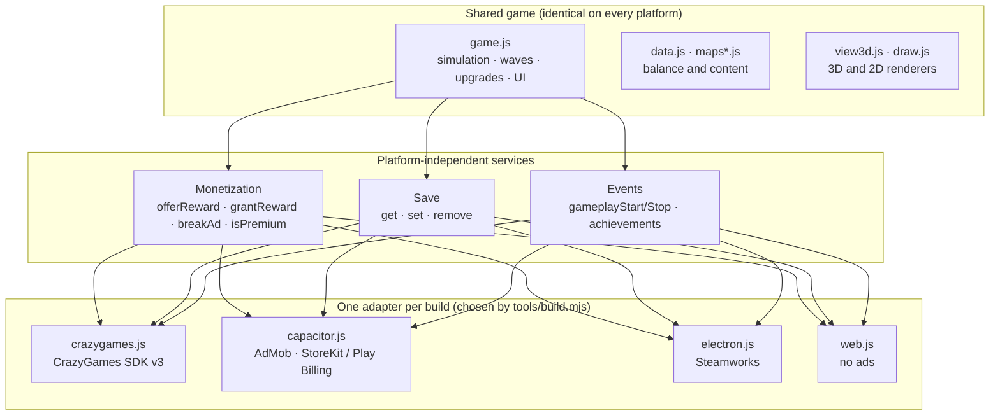

# Ringwarden: Orbital Defense — multi-platform architecture and roadmap

Status: **proposal for review.** Nothing in the game has been changed by this document.
Audited at commit `20c927e` (main, v3.1.0 — the build submitted to CrazyGames Basic Launch).

Items marked **[verify]** are platform rules or SDK facts that must be confirmed against the vendor's current
documentation before we build on them. They were not checked against primary sources while writing this.

---

## 1. Assessment of the current repository

**Technology stack**

| Area | What we have |
| --- | --- |
| Language | Plain JavaScript (ES2020), HTML, CSS. No framework, no bundler, no npm runtime dependencies. |
| Rendering | Three.js 0.186.1, vendored in `vendor/three/` (3D view); Canvas 2D (Classic 2D view). |
| Audio | Web Audio, all sounds and music generated in code (no audio files). |
| Build | `tools/build.mjs` (Node, zero dependencies): copies the game, injects platform settings per target, zips. `tools/flatten.mjs` makes the one-folder CrazyGames upload. |
| Size | ~2.7 MB unpacked, 23 files. Loads in seconds; far below every store limit. |
| Hosting | GitHub Pages serves `main` as the public web version (installable PWA, offline). |

**Code layout (5,600 lines of JS)**

| File | Lines | Role |
| --- | --- | --- |
| `js/game.js` | 1,943 | Simulation, combat, waves, UI, menus, input, saves, tutorial (one module) |
| `js/view3d.js` | 926 | Three.js renderer for the 3D view |
| `js/sat3d.js`, `js/aliens3d.js` | 769 | 3D models |
| `js/draw.js`, `js/bodies.js` | 591 | Classic 2D art |
| `js/data.js`, `js/maps.js`, `js/maps3d.js` | 467 | Balance data: satellites, enemies, waves, difficulties, maps |
| `js/platform.js` | 126 | **Platform layer** (see below) |
| `js/audio.js`, `js/leaderboard.js`, `js/analytics.js`, `js/mode.js`, `js/config.js` | 368 | Audio, local leaderboards, GoatCounter stats, view switch, config |

**The single most important finding:** the "one shared codebase" requirement is already met. Every
platform build copies the *same* game files; only `js/platform.js` behaves differently, chosen at build time
by `window.OD_PLATFORM`. Gameplay never calls an SDK directly. It calls:

```
OD.platform.save.get/set/remove        storage
OD.platform.ads.rewardedAvailable()    is a rewarded bonus offered?
OD.platform.ads.rewarded() → bool      show a rewarded ad, resolve true if earned
OD.platform.ads.midgame()              natural-break ad (only when leaving an end screen)
OD.platform.gameplayStart/Stop, loadingDone, happy, achievement(id), init()
```

**Platform targets that exist today** (`tools/build.mjs`)

| Target | Status |
| --- | --- |
| `web` (GitHub Pages) | Live. No ads. Analytics on (opt-out). |
| `itch` | Built; itch.io page still on v1. |
| `crazygames` | CrazyGames SDK v3: rewarded ads, midgame ad, data-module saves, gameplay events, 6 s SDK timeout. Kept for Full Launch. |
| `crazygames-basic` | Same with every ad off (`OD_NO_ADS`). **Submitted for Basic Launch.** |
| `electron` | Scaffold in `platforms/electron/`: Electron window, `app://` protocol, F11 fullscreen, optional `steamworks.js` achievements + overlay. Not yet released or tested on Windows hardware. |
| `mobile` | Scaffold in `platforms/mobile/`: Capacitor 8 config + status-bar plugin. **No native Android/iOS projects generated yet**, no ads, no purchases. |

**Where monetization touches gameplay** (all in `js/game.js`; the only places that change):

1. `watchAdForCredits()` — between waves, once per wave (`S.adWave`), grants `(60 + wave×12) × difficulty` credits.
2. The 📺 button's visibility (`updateUI`).
3. Revive offer on the game-over screen — once per run (`S.revived`), 5 HP.
4. Midgame ad when leaving an end-of-game screen.

**Gaps and debts found**

- **Automated tests are not in the repository.** About 60 Playwright scripts used during development
  (CrazyGames SDK stand-in, saves, all maps, tutorial, layout, rotation, perf) live outside the repo. Moving them
  in is the first job: they are the safety net for everything below.
- No CI. Builds and tests are run by hand.
- `game.js` mixes simulation and UI. This is **not** a problem for multi-platform (all platforms share it), so a
  split is *not* proposed now; see §7 risks.
- Save keys (`od_run`, `od_rec`, `od_lb`, `od_tut_done`, …) are stable and must stay stable; renaming any of them
  would wipe players' progress.
- `package.json` names in `platforms/` still say "Orbital Defense" / `3.0.0-dev`; app IDs use
  `io.github.savior99748.orbitaldefense` (fine to keep, but **app IDs can never change after a store release**).

---

## 2. Proposed directory and module structure

Evolution, not a rewrite. New or changed items are marked ★.

```
index.html                    page shell (unchanged)
js/
  config.js data.js maps*.js  ── core: balance + content (unchanged)
  game.js                     ── core: simulation, UI, progression (4 call sites switch to Monetization)
  view3d.js sat3d.js aliens3d.js draw.js bodies.js audio.js   ── core: presentation (unchanged)
  services/
    monetization.js      ★    one interface for rewards, interstitials, premium (see §5)
    entitlements.js      ★    "premium owned?" — stored locally, refreshed from the store
  platform/
    platform.js               shared defaults + interface (today's file, trimmed)
    web.js               ★    split out of platform.js
    crazygames.js        ★    split out of platform.js (unchanged behavior)
    capacitor.js         ★    AdMob + store billing + app lifecycle + safe areas
    electron.js          ★    Steam bridge, cloud saves, display settings
platforms/
  electron/                   Steam / desktop wrapper (exists)
  mobile/                     Capacitor project (exists); android/ and ios/ generated here once ★
tests/                   ★    Playwright suites moved into the repo, one per platform + core
tools/build.mjs               targets select which platform/*.js file ships (★ small change)
.github/workflows/       ★    CI: run tests on every PR; build platform zips as artifacts on tags
docs/                         this file, release checklists per store ★
```

**Build targets** (each copies the shared game plus exactly one adapter):

| Target | Adapter shipped | SDKs present | Ads |
| --- | --- | --- | --- |
| `web` | `web.js` | none | none |
| `crazygames-basic` | `crazygames.js` | CrazyGames SDK | off |
| `crazygames` | `crazygames.js` | CrazyGames SDK | rewarded + midgame |
| `mobile-android`, `mobile-ios` | `capacitor.js` | AdMob, store billing (native plugins) | rewarded only, removed by premium |
| `steam` | `electron.js` | steamworks (native, desktop wrapper only) | **none — no ad code shipped** |

Because the adapter is chosen by *which file is copied*, the CrazyGames SDK cannot end up in a native build and
ad code cannot end up in the Steam build. A build-time check (★) fails the build if a forbidden string
(`sdk.crazygames.com`, `admob`) appears in the wrong target's output.

---

## 3. How the pieces interact



---

## 4. Recommended tools, frameworks and SDKs

| Need | Recommendation | Why | Verify |
| --- | --- | --- | --- |
| Mobile packaging | **Capacitor** (already in repo, v8) | Runs our HTML5 game in a native shell; real native plugins; no rewrite | Capacitor 8 support for every plugin below **[verify]** |
| Mobile ads | **Google AdMob** via `@capacitor-community/admob` | Rewarded ads on iOS and Android; plugin also handles Google's consent form (UMP) | Plugin version compatible with Capacitor 8 **[verify]**; iOS App Tracking Transparency prompt for personalized ads **[verify]** |
| Mobile purchases | **RevenueCat** (`@revenuecat/purchases-capacitor`) — or, without a third party, `cordova-plugin-purchase` (works under Capacitor) | RevenueCat validates receipts on its servers and handles restore across devices, so we need no backend of our own. Free tier for small revenue **[verify pricing]** | Capacitor 8 compatibility **[verify]** |
| Desktop / Steam | **Electron** (already in repo) + `steamworks.js` | Same game files; Windows build via `electron-builder`; achievements already wired | `steamworks.js` maintenance status and Electron 45 compatibility **[verify]**; Steam overlay with Electron is known to be fragile **[verify]** |
| Tests | **Playwright** (already used) | Same scripts drive desktop, phone emulation and SDK stand-ins | — |
| CI | **GitHub Actions** | Tests on every PR, build artifacts on tags | — |

Not recommended: moving to Unity/Godot (a rewrite with no gameplay benefit), Tauri for Steam (its system
WebView differs per PC and has weaker WebGL guarantees than Electron's bundled Chromium), or bundling an ad SDK
in JavaScript inside the app (stores and ad networks expect the native SDKs).

---

## 5. Monetization architecture

### One interface for the whole game

```js
// js/services/monetization.js — the only monetization API gameplay may call
Monetization.offer(kind)        // → { available, label, method: "ad" | "premium" | "none" }
Monetization.claim(kind, key)   // → Promise<{ granted: boolean }>, never grants the same key twice
Monetization.breakAd()          // natural pause point (leaving an end screen); no-op where not allowed
Monetization.isPremium()        // true on Steam (paid), true on mobile after purchase, false elsewhere
Monetization.buyPremium()       // mobile only
Monetization.restore()          // mobile only (Apple requires a visible "Restore Purchases" button) [verify]
```

`kind` is `"credits"` (between waves) or `"revive"` (after losing). `key` makes every grant idempotent:
`credits:<runId>:<wave>` and `revive:<runId>`. A grant is recorded **before** the reward is applied and the
record is saved with the run, so a double callback, a second tap, an app kill mid-ad or a resumed save cannot pay
twice. This replaces today's `S.adWave` / `S.revived` checks with the same rules in one place.

### Per platform

| | CrazyGames (Full) | CrazyGames (Basic) | Mobile free | Mobile premium ($2.99) | Steam ($2.99–4.99) | Web |
| --- | --- | --- | --- | --- | --- | --- |
| Bonus credits between waves | rewarded ad, once/wave | — | rewarded ad, once/wave | **free button, once/wave** | **free button, once/wave** | — |
| Revive after losing | rewarded ad, once/run | — | rewarded ad, once/run | **free, once/run** | **free, once/run** | — |
| Ad between games | midgame ad | — | none (not proposed) | none | none | none |
| Purchase | — | — | "Remove ads — $2.99" + Restore | owned | game itself | — |

**Premium equivalent of rewarded ads:** a premium player gets the *same* bonus, at the *same* limits, without
watching anything — "Claim bonus" instead of "Watch ad". No extra currency, no stronger satellites, no unlimited
claims: the caps (one bonus per wave, one revive per run) are what keep balance, and they stay identical. Optional
cosmetic thank-you for premium (e.g. a gold satellite trim) — cosmetic only.

**Purchases:** one non-consumable product (`premium_remove_ads`). Entitlement is cached locally so the game works
offline, refreshed from the store on launch and on "Restore". Premium state lives in the store, not in the save
file, so reinstalling or a new device restores it through the store account. With RevenueCat, receipt
validation is server-side; without it, local validation only (simpler, easier to spoof — acceptable for $2.99,
decision for you).

**Never show ads to premium users:** `Monetization` checks `isPremium()` before any ad call, and the mobile
adapter refuses to load ad units at all once premium is confirmed.

---

## 6. GitHub branching and release strategy

Keep it trunk-based — one game, no long-lived platform branches.

- **`main`** is always releasable and is what GitHub Pages serves. Protect it: changes only via pull request,
  CI must pass.
- **Feature branches** (`feature/mobile-billing`, `feature/steam-settings`, `fix/…`) are short-lived and merge
  to `main` behind build-time switches, so unfinished mobile or Steam work never reaches the CrazyGames build.
- **Platform code lives in platform modules, never in platform branches.** A gameplay change merged to `main`
  reaches every platform on its next build automatically.
- **Release tags per platform:** `crazygames-v3.1.0`, `steam-v1.0.0`, `android-v1.0.0`, `ios-v1.0.0`. CI builds
  the matching artifact from the tag and attaches it to a GitHub Release. Platforms release on their own schedule
  from whatever `main` was at their tag.
- **Rollback:** re-upload the previous tag's artifact (CrazyGames, Steam). For the stores, ship a new build from
  the previous tag (stores do not allow re-publishing an older binary as-is) **[verify per store]**.
- **Store versions:** `package.json` version per release; Android `versionCode` and iOS build number increase on
  every upload.

---

## 7. Phased roadmap

Complexity: **S** ≈ a session, **M** ≈ a few sessions, **L** ≈ a week or more of work, mostly waiting on stores.

| Phase | Work | Complexity | CrazyGames impact |
| --- | --- | --- | --- |
| **1. Preparation** | Move the Playwright suites into `tests/`; GitHub Actions running them on every PR; release tags for v3.1.0. | **S** | None (adds tests only) |
| **2. Shared services** | `monetization.js` + idempotent grants; switch the 4 call sites; split `platform.js` into adapters; build selects adapter; forbidden-SDK build check. | **M** | Touches ad code — gated by the CrazyGames test suite; must produce identical behavior |
| **3. Mobile** | Generate Android/iOS projects; `capacitor.js` (AdMob rewarded, consent, billing, restore, pause/resume, safe areas, back button); "Remove ads" screen; test builds on real devices; store listings, privacy labels / data safety forms. | **L** | None (separate adapter) |
| **4. Steam** | Settings menu (fullscreen/windowed, resolution scale, vsync); Steam Cloud saves; achievements already wired; Windows installer; Steam capsule art and store page; test on Windows. | **M–L** | None |
| **5. Launches** | Per-store checklists in `docs/`; closed testing on Google Play; TestFlight on iOS; Steam "Coming Soon" page live early for wishlists; release. | **L** (calendar time) | None |

Suggested order after Phase 2: **Steam "Coming Soon" page early** (wishlists need weeks), **Android** next
(cheapest, testers' clock can run in parallel), **iOS** last.

---

## 8. Risks to the current CrazyGames version

| Risk | Mitigation |
| --- | --- |
| Refactoring ad calls changes when ads show or how much they pay | Phase 2 keeps the same rules; CrazyGames suite (SDK stand-in: no ads in Basic, rewarded/revive/midgame in Full, save events) must pass before merge |
| Splitting `platform.js` breaks SDK loading or the 6 s timeout | Same tests; plus a manual QA preview on CrazyGames before uploading |
| Build script change injects the wrong SDK tag or drops `OD_NO_ADS` | Forbidden-string build check; diff of built `index.html` against the previous release |
| Save key changes wipe progress | Rule: save keys are frozen; a test loads a v3.1.0 save |
| `flatten.mjs` misses a new file path | Flat-build test already loads the 3D view from the flattened folder |
| Unfinished mobile/Steam work leaks into the web build | Code lives in adapters only the matching target copies |
| Full-repo restructure of `game.js` | **Not proposed.** It would touch everything for no platform benefit. Revisit only if gameplay growth demands it. |

---

## 9. Decisions and accounts needed from you

**Accounts** (need your identity and payment; cannot be done for you)
1. **Google Play Console** developer account (one-time fee **[verify current amount]**). New personal accounts
   must run a closed test with a minimum number of testers for a minimum period before production **[verify
   current numbers]** — line up testers early.
2. **Apple Developer Program** (yearly fee **[verify]**) and access to a **Mac with Xcode** (or a cloud Mac / CI
   build service) — iOS apps cannot be built or signed on Windows.
3. **Steamworks** partner account and app fee per game **[verify]**; tax and bank details.
4. **AdMob** account (ad units, app IDs, payment profile).
5. **RevenueCat** account — only if you choose it for purchases.

**Decisions**
6. Final store name: "Ringwarden: Orbital Defense" everywhere? (Store names and bundle IDs are hard or impossible
   to change later; the trademark question from earlier still applies.)
7. Bundle/application ID: keep `io.github.savior99748.orbitaldefense`, or a company-style ID such as
   `com.<yourstudio>.ringwarden`. **Permanent once published.**
8. Steam price ($2.99, $3.99 or $4.99) and whether to add Steam-only extras.
9. Purchases: RevenueCat (server validation, a third party) or on-device validation only.
10. Mobile ads: rewarded only (proposed), or also between-game interstitials for free users.
11. A legal business name/address for the stores (they publish developer contact details), and an updated
    privacy policy covering AdMob and purchases.

---

## Next step

On approval, start **Phase 1** (tests into the repository + CI). It changes no game code and makes every later
phase safe for the CrazyGames build.
